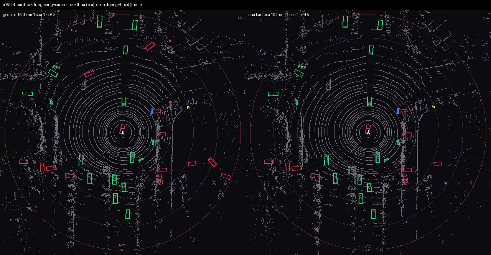

# Báo cáo Day 14 — Nguyễn Việt Anh — 2A202603095

- Mã học viên dùng với `--student`: `095`
- `seed_tag` trong `frames_A.txt`: `393590736f`

## 1. Dự đoán trước sweep (bước 5b)

Ghi **trước** khi chạy `scripts/pp_sweep.py`, rồi commit và push ngay (lịch sử commit là bằng chứng thời điểm viết). Không sửa phần này sau khi có kết quả.

- Tham số tôi nghĩ giảm công sửa nhiều nhất: `score_thr=0.35` và `min_points=5`.
- Vì sao: Khi sửa 3 frame tập A, tôi thấy các hộp thừa thường nằm trên hàng cây và quanh vị trí xe mang cảm biến LiDAR. Cấu hình gốc có 30 hộp cần xóa và 3 hộp cần thêm. Tôi dự đoán lọc chặt hơn sẽ giảm công xóa hộp thừa.

## 2. Tập A: sửa tay và tune

| Cấu hình | Xóa | Thêm | Sửa | Chi phí |
|---|---:|---:|---:|---:|
| Gốc | 30 | 3 | 3 | 13.5 |
| `best_config.json` | 17 | 5 | 3 | 11.6 |

Ở cấu hình gốc, ba frame lần lượt có 5, 9 và 16 hộp cần xóa. Mỗi frame có 1 hộp cần thêm và 1 hộp cần sửa. Trong tổng chi phí 13,5 điểm, các thao tác xóa chiếm 9 điểm.

- Cấu hình được chọn tăng `score_thr` từ 0.1 lên 0.3 và `min_points` từ 0 lên 5. Hai mức `min_points=5` và `min_points=10` cùng đạt 11,6 điểm ở `score_thr=0.3`. Sweep ghi mức 5 vào `best_config.json`.

| Frame giữ lại để kiểm tra | Cấu hình chọn trên hai frame còn lại | Chi phí trên frame giữ lại | Chi phí thấp nhất trên frame đó |
|---|---|---:|---:|
| `s03f04` | `score_thr=0.3`, `min_points=5` | 3.7 | 3.0 |
| `s04f32` | `score_thr=0.3`, `min_points=5` | 3.4 | 3.3 |
| `s05f24` | `score_thr=0.2`, `min_points=5` | 5.7 | 4.5 |

Leave-one-out chọn cùng cấu hình ở hai trong ba lượt. Khi giữ lại `s05f24`, ngưỡng score được chọn giảm xuống 0.2 và chi phí trên frame đó cao hơn mức tốt nhất 1,2 điểm. Bài lab dùng cấu hình đạt tổng chi phí thấp nhất trên cả 3 frame A để tạo pre-label cho tập B.

## 3. Trước/sau (bước 8)

- Chi phí trên tập A giảm từ 13,5 xuống 11,6 điểm, tương đương 14%. Theo từng frame, `s03f04` tăng từ 3,0 lên 3,7, `s04f32` giảm từ 4,2 xuống 3,4 và `s05f24` giảm từ 6,3 xuống 4,5.
- Đối chiếu với mục 1: trên tập A, số hộp cần xóa giảm từ 30 xuống 17, số hộp cần thêm tăng từ 3 lên 5 và số hộp cần sửa giữ nguyên ở 3. Theo công thức của lab, bớt 13 lượt xóa giảm 3,9 điểm, còn thêm 2 lượt vẽ tăng 2 điểm, nên tổng chi phí giảm 1,9 điểm.
- Dự đoán dùng `score_thr=0.35` và `min_points=5`. Sweep chọn `score_thr=0.3` và `min_points=5` trong 15 cấu hình đã thử. Mức 0.35 nằm ngoài lưới nên chưa có số đo trực tiếp cho cấu hình dự đoán.

## 4. Tập B

Số đo từ `scripts/pp_prelabel.py --frames d14_095/frames_B.txt --config d14_095/best_config.json --gt d14_095/ref_B.json`:

| Xóa | Thêm | Sửa | Chi phí |
|---:|---:|---:|---:|
| 187 | 14 | 2 | 71.1 |

- Khi sửa tập B, tôi thấy mỗi frame vẫn còn nhiều hộp phải xóa. Kết quả đo ghi nhận từ 9 đến 24 hộp cần xóa mỗi frame, tổng cộng 187 trong 302 hộp dự đoán (khoảng 62%). Tập B được đo với cấu hình đã chọn. Mức giảm 14% ở mục 3 được đo trên tập A.
- `Car` có chi phí cao nhất trong phép đo theo lớp. Có 107 hộp dự đoán cần xóa, 2 hộp tham chiếu cần thêm và 1 hộp khớp cần sửa, tổng cộng 34,6 điểm. Hộp bị xóa được tính theo lớp dự đoán. Hộp thêm hoặc sửa được tính theo lớp tham chiếu.

## 5. Giới hạn

- Tập tune chỉ có 3 frame nên ngưỡng chọn được có thể thay đổi trên các cảnh khác.
- PointPillars được huấn luyện trên KITTI với ba lớp Car, Cyclist và Pedestrian. Truck và Bus được suy ra qua luật hậu xử lý và cần người kiểm lại lớp, kích thước và hướng.
- Chi phí sửa là tổng có trọng số của số hộp xóa, thêm và sửa. Bài làm chưa đo thời gian thao tác trên CVAT.
- Khi sửa tập A, tôi dùng addon CVAT local để tô điểm LiDAR trong cuboid, xem vòng 50 m và rà các hộp pre-label theo score, vị trí và chiều cao. Tôi kiểm tra và chỉnh nhãn trên CVAT trước khi xuất nhãn tham chiếu.
